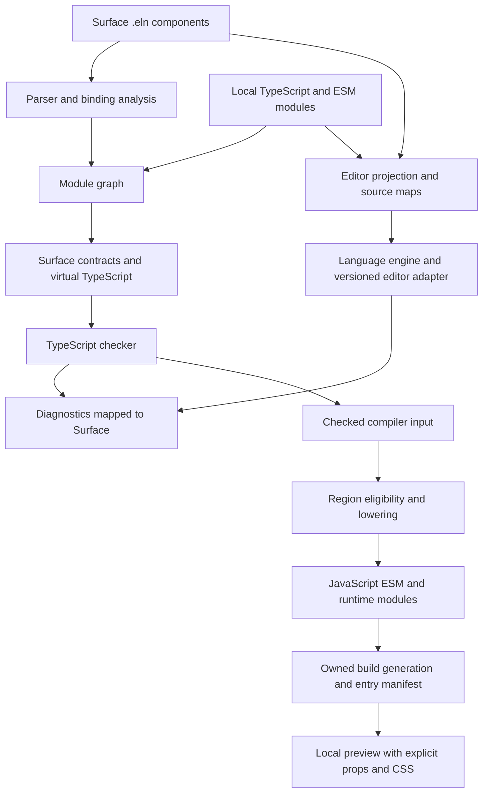
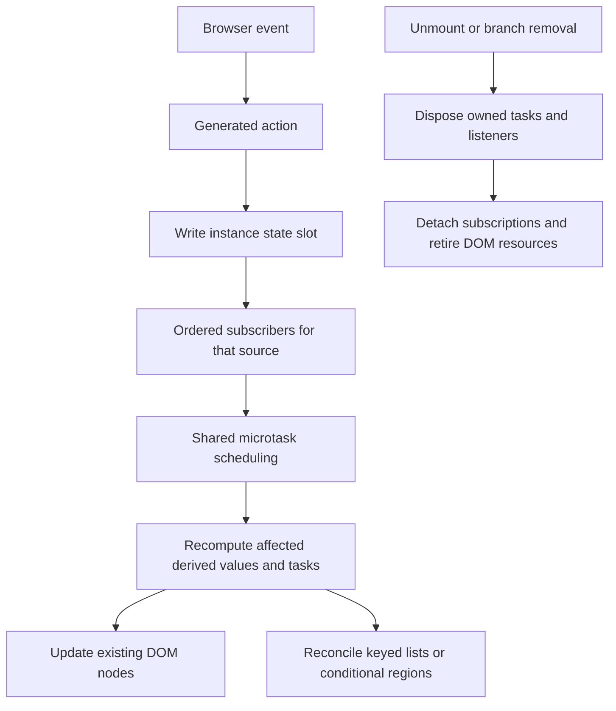
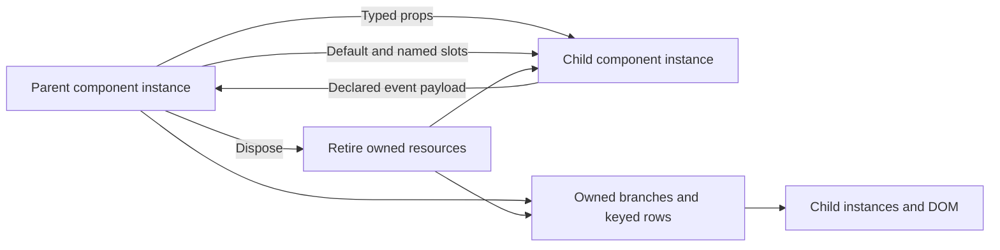

# Current Elnor architecture

Implementation snapshot: 2026-11-16. This describes the public source, not the
full proposed Surface specification. See [integration evidence](CORE-REGION-INTEGRATION.md)
and [ecosystem roadmap](ECOSYSTEM-ROADMAP.md).

## Compilation and tooling

`parser.mjs` recognizes the bounded Surface grammar. `binding-analysis.mjs`
preserves TypeScript binding identity for transformations. `checker.mjs` checks
virtual TypeScript contracts, while the editor projection and language engine
map supported language operations to original source positions. These are
related tooling paths, not an assertion that the strict build parser is a
complete incremental editor parser.

`module-plan.mjs` packages a bounded relative local ESM graph. `compiler.mjs`
emits JavaScript and asks `region-compiler.mjs` for eligible optimized plans.
Project build/preview retain checked generations and a last valid build rather
than executing a partially emitted project. The preview is development tooling,
not a production application server.

## Runtime updates

The regional backend uses instance frames, indexed state, task dependency
tracking and ordered per-source subscriber sets. Eligible owned views receive
generated native DOM construction. Other eligible views use region descriptors;
unsupported shapes retain the general renderer. The general renderer also uses
reactive cells/effects and direct DOM operations.

There is no general virtual DOM tree rebuilt and diffed for each update.
Descriptors are execution plans, not a per-update virtual DOM. Lists still need
keyed reconciliation; direct DOM updates do not remove that work. Dependency
tracking, scheduling and lifetime cleanup still have runtime costs.

## Ownership and composition

Ownership makes cleanup explicit internally without adding disposal bookkeeping
to ordinary component authors. Props, events and slots form checked boundaries.
Deep mutation tracking, general user lifecycle hooks, DOM refs, arbitrary DOM
attributes and third-party component adapters are not established by this
diagram.

## Distinctive combination and limits

Elnor combines explicit Surface declarations (`state`, `calc`, `action`, typed
events and slots), TypeScript semantics with original-source feedback,
compiler-selected direct DOM execution, and owned cleanup. These individual
ideas have precedents. The product hypothesis is that their combination makes
authoring and maintenance clearer while preserving competitive execution.
Independent human evaluation must still establish that DX advantage.

Direct DOM compilation is also used elsewhere, including Svelte; it is not by
itself Elnor's unique advantage. Current differentiation is the Surface contract
and tooling approach. Bounded majority CPU parity is measured; universal speed
superiority, ecosystem maturity and production readiness are not established.

Source anchors: [compiler](../../src/compiler.mjs),
[region compiler](../../src/region-compiler.mjs),
[regional runtime](../../src/region-runtime.mjs),
[general runtime](../../src/runtime.mjs), [checker](../../src/checker.mjs),
[projection](../../src/language-projection.mjs),
[module planner](../../src/module-plan.mjs).
